# 미니 PJT: Gemini Enterprise 설정 지원 에이전트

> 근거 있는 진단, 승인 후 조치

## 무엇을 푸나

Gemini Enterprise 관리자가 SharePoint 커넥터 설정 문의(전달받은 메일·오류 메시지)를 붙여넣으면, 개인정보를 가린 뒤 공식 문서와 (가상) 테넌트 상태를 근거로 **원인 후보와 조치 순서**를 안내하고, 설정을 바꾸는 조치는 **관리자가 승인한 뒤에만** 실행한다.

- 사용자·문제·가치, 가드레일, 성공 기준: [SERVICE.md](SERVICE.md)
- 범위: 셋업·운영 단계의 SharePoint 커넥터 연동 장애 6종(F1~F6, [data/faults.json](data/faults.json)에 장애별 공식 문서 URL). 모든 테넌트·메일 데이터는 가상이다.

## 활용한 패턴 (Day 1~7)

| # | 패턴 | Day | 이 프로젝트에서 |
|---|---|---|---|
| 1 | LCEL 구조화 출력 | Day 1 | `analyze`(의도·증상·한/영 검색어)와 `plan_runbook`(원인·런북)을 Pydantic 스키마로 받음 |
| 2 | ReAct (도구 자율 선택) | Day 3 | `agent` 노드가 최대 8단계 동안 도구를 스스로 골라 호출 |
| 3 | RAG (하이브리드 검색) | Day 2 | Chroma(Bedrock Titan v2) + BM25(kiwipiepy) 결과를 RRF로 합침, 한국어+영어 검색어 |
| 4 | 도구 다중 | Day 4 | `retrieve_docs`·`check_tenant_state`·`propose_fix` 3개를 한 질의에서 결합 |
| 6 | 가드레일 | Day 5 | 이메일·전화·시크릿 마스킹(그래프 전, fail-closed), 붙여넣은 내용 속 인젝션 탐지, 비밀값 요청 거절, 근거 없으면 '확인 필요' |
| 7 | HITL (위험 작업 승인) | Day 5 | `approval_gate`의 `interrupt()`에서 멈추고 approve일 때만 `apply_fix`, 같은 조치는 1회만 |
| 8 | 미들웨어 (마스킹) | Day 5 | 단일 진입점 `handle_query` 첫 단계에서 `mask_pii`, 출력 단계에서 재마스킹 |
| 10 | Plan-Execute | Day 7 | `plan_runbook`이 진단 결과를 단계별 런북(위험도·출처)으로 계획 |
| 11 | Trace | Day 7 | 응답 `trace[]`에 노드·도구별 입력/출력(마스킹본), LangSmith 트레이스(선택) |
| 12 | 평가 | Day 7 | 인-아웃 세트 18건 문자열 규칙 판정 + RAGAS 4지표 + 원문 유출·근거 검사 |

## 아키텍처



*상자와 테두리 = 구조, 번호 화살표 = 순서, 빨간 선 = 보안 처리(마스킹·승인 후 변경). 움직이는 버전: [runbook-assistant.html](.archify/architecture-runbook-assistant-20261125-110552/runbook-assistant.html)*



*셋업 → 프로비저닝(사용자 계정 공급) → 온보딩 → 운영. 이번 구현은 셋업·운영 단계의 설정 진단(보라 상자). 움직이는 버전: [ge-setting-stages.html](.archify/lifecycle-ge-setting-stages-20261125-135026/ge-setting-stages.html)*

```
관리자 문의 ─▶ handle_query ─▶ mask_pii (그래프 밖, D-6)
                   │
                   ▼  LangGraph (SqliteSaver checkpoint)
   input_guard ─▶ analyze(LCEL) ─▶ agent(ReAct) ─▶ plan_runbook ─▶ approval_gate ─▶ output_guard
                                     │  도구: retrieve_docs · check_tenant_state · propose_fix
                                     ▼                                │ interrupt (HITL)
                       공식 문서 인덱스 / 가상 테넌트          approve 시에만 apply_fix
                   │
                   ▼
   {answer, contexts[{doc_id,text}], trace[{step,input,output}]} + 선택 필드 diagnosis·approval_required·thread_id·pending_action
```

- 진입점은 `handle_query` 하나다. FastAPI(`POST /query`), Streamlit 화면, 평가 실행기가 모두 이 함수만 부른다.
- 에이전트에게는 상태를 바꾸는 도구가 없다. `propose_fix`로 제안만 하고, 실제 변경은 `approval_gate`가 승인 뒤에 한다.
- 장애는 그래프 밖에서 시나리오(S00~S08)로 주입하고, 가상 테넌트는 thread마다 메모리 복사본을 쓴다.

## 실행 방법

```powershell
# 1) 가상환경과 패키지 (Python 3.14 기준)
py -3.14 -m venv .venv
.venv\Scripts\python -m pip install -r requirements.txt

# 2) 키 설정: .env.example을 .env로 복사한 뒤 AWS Bedrock 키 입력 (LangSmith는 선택)
copy .env.example .env

# 3) (선택) 공식 문서 다시 수집 - data/docs/에 이미 들어 있음
.venv\Scripts\python scripts\collect_docs.py

# 4) API 서버
.venv\Scripts\python -m uvicorn api:app --app-dir src --port 8000
#    curl -X POST localhost:8000/query -H "Content-Type: application/json" -d "{\"question\": \"...\", \"scenario_id\": \"S04\"}"
#    승인: {"thread_id": "<응답의 thread_id>", "decision": "approve"}

# 5) 화면 (샘플 응답 모드는 Bedrock 호출 없이 동작)
.venv\Scripts\python -m streamlit run app.py

# 6) 평가 (18건, RAGAS 채점 모델 Haiku)
.venv\Scripts\python -X utf8 evaluation\run_eval.py --round 2 --ragas-model haiku
```

- 첫 실행 때 Chroma 인덱스(`chroma_db/`)를 만든다(Bedrock 임베딩 호출). API 서버·Streamlit·평가 실행기는 시작할 때 인덱스를 먼저 준비하므로, 깨끗한 clone에서는 서버가 뜨기까지 1분 남짓 걸린다(점검: 서버 준비 77초, 첫 요청 19초).
- LLM-as-Judge: `.venv\Scripts\python -X utf8 evaluation\llm_judge.py evaluation\round4_results.json` (judge 모델 Claude Sonnet 4.5 고정)
- 모델: 에이전트 Claude Sonnet 4.5, 분석 Claude Haiku 4.5 (Bedrock `us-east-1`), temperature 0.

## RAGAS 평가 결과

positive·edge 11건, 채점 모델 Claude Haiku 4.5 (1차는 저장된 답변을 같은 모델로 다시 채점해 비교)

| 지표 | 1차 | 2차 | 3차 | 4차 | 5차 (최종) |
|---|---|---|---|---|---|
| faithfulness | 0.241 | 0.734 | 0.853 | 0.893 | **0.886** |
| answer_relevancy | 0.447 | 0.388 | 0.338 | 0.312 | 0.272 |
| context_precision (with reference) | 0.600 | 0.503 | 0.524 | 0.508 | 0.512 |
| context_recall | 0.667 | 0.909 | 0.909 | 0.939 | 0.939 |

- 1차 원본 보고서(Sonnet 채점): [evaluation/round1_report.md](evaluation/round1_report.md) — faithfulness 0.111
- reference는 정답 장애 이름과 공식 문서 근거 요약으로 만들었다.
- 3차에서 faithfulness가 필수 기준 0.8을 넘었고(0.853), 강사 피드백을 반영한 4차에서 0.893(0.8 이상 10/11건)이 됐다. answer_relevancy는 라운드마다 내려갔다 — 근거성을 우선해 답변을 근거 나열 위주로 바꾼 대가다(분석: [round3_report.md](evaluation/round3_report.md) §5, [round4_report.md](evaluation/round4_report.md) §5).

## 인-아웃 세트 통과율 (자체 평가)

- 1차 (Day 9 종료): **14 / 18 통과** (positive 6/7, negative 4/4, edge 3/4, guardrail 1/3)
- 2차 (Day 10 개선 후): **18 / 18 통과** (positive 7/7, negative 4/4, edge 4/4, guardrail 3/3) — [evaluation/round2_report.md](evaluation/round2_report.md)
- 3차 (faithfulness 개선): **18 / 18 통과**, faithfulness 0.734 → 0.853 — [evaluation/round3_report.md](evaluation/round3_report.md)
- 4차 (강사 피드백 반영: 값 비교를 코드로): **18 / 18 통과**, faithfulness 0.893, positive·edge 반복 실행에서 1순위 원인 11/11 동일 — [evaluation/round4_report.md](evaluation/round4_report.md)
- 5차 (강사 힌트 집중 점검 반영: 코드가 '문제/문제 아님'까지 판정): **18 / 18 통과**, faithfulness 0.886 — [evaluation/round5_report.md](evaluation/round5_report.md)
- 강사 힌트 집중 점검(값 비교 원인 변형 20개, 같은 모호한 문의): checks 없음 14/20 → 비교값만 14/20 → **문제 판정까지 20/20** — [evaluation/stress_hint_report.md](evaluation/stress_hint_report.md)
- 개선폭: 통과 **+4건**(1차→2차), faithfulness **0.241 → 0.893** / 주요 개선 사항: 평가기 판정 오류 수정, 마스킹 토큰 재탐지 버그 수정, F3·F4 구분 규칙, 원인별 근거 재검색, 테넌트 상태를 근거로 포함, 답변과 메타데이터 분리

LLM-as-Judge (positive·edge 11건, judge Claude Sonnet 4.5, 1~5점): 정확성 4.82 · 근거성 5.00 · 실행 가능성 4.82 · 안전성 5.00 (4차). judge는 답변 문장만 보고 장애 번호 표기 오류는 잡지 못해, 통과 여부는 규칙 판정으로 한다 — [round4_report.md](evaluation/round4_report.md) §6

평가 세트: [evaluation/test_queries.csv](evaluation/test_queries.csv) (positive 7 · negative 4 · edge 4 · guardrail 3, 이 중 5건은 원인 이름만 본 별도 AI가 작성한 "AI 작성 준블라인드" 케이스로 튜닝 전에 고정)

## 트라이앤에러 회고

**시도했지만 실패한 접근 · 왜 실패했는가**
- 답변 한 덩어리에 원인 번호·확신도·위험도·출처까지 모두 넣었다 → RAGAS faithfulness가 0.11. 문장별 판정을 열어 보니 사실 문장은 근거 있음으로 판정되고, "원인 후보 1의 확신도 0.98" 같은 메타데이터 문장이 근거 없음으로 채점되고 있었다.
- 테넌트 조회 결과를 근거(contexts)에 넣지 않았다 → 답이 테넌트 상태를 근거로 말해도 채점기는 확인할 방법이 없었다.
- 원인마다 근거 doc_id가 검색 결과에 있어야 한다는 필터(G5)를 그대로 적용 → 장애가 2개인 E1에서 두 원인이 모두 지워졌다.
- 금지 문구를 trace 전체에서 찾게 한 평가기 → 입력에 들어 있던 인젝션 문장 때문에 G1이 잘못 실패했다. 이미 가린 `[SECRET]` 토큰을 다시 시크릿으로 잡는 마스킹 버그로 G2가 차단됐다.
- 하루에 평가를 여러 번 돌리다 Bedrock 일일 토큰 한도에 걸려 2차 평가 두 번이 중간에 실패했다(무효 처리, `round2_attempt*_INVALID_*`).

**최종 채택한 접근 · 왜 그것으로 갔는가**
- answer는 근거 있는 문장과 조치 순서만, 메타데이터는 `diagnosis` 구조화 필드로 분리 → 사람이 읽기 쉽고 채점도 공정하다.
- 테넌트 상태와 제안 조치를 `tenant-state`, `fix:<id>` 항목으로 contexts에 포함, 문서 청크 앞에 출처·라이선스·수집일 머리말.
- 근거가 없는 원인은 지우기 전에 장애 이름·근거 요약으로 한 번 더 검색.
- 채점 모델을 Haiku로 바꾸고, 1차 결과도 같은 모델로 다시 채점해 1차·2차를 공정하게 비교. 한도 오류가 나면 평가를 즉시 멈추도록 평가기 보완.

**남은 한계 · 향후 개선 방향**
- 사람 이름 마스킹은 규칙 기반이라 놓칠 수 있다(SERVICE.md 알려진 한계).
- 실제 테넌트 변경은 하지 않는다(가상 테넌트). 확장 시 위험도 낮은 조치부터 Graph API 실행.
- 프로비저닝·온보딩 단계, SharePoint 외 커넥터로 장애 목록 확장. 문서용 MCP(Google Developer Knowledge, Microsoft Learn)로 문서 수집 자동화.

## 핵심 코드 위치

- [src/agent.py:324](src/agent.py) — 메인 에이전트 그래프 `build_graph` (노드 6개), [src/agent.py:372](src/agent.py) 단일 진입점 `handle_query`
- [src/agent.py:127](src/agent.py) — LCEL 구조화 출력 `analyze_chain`, [src/agent.py:216](src/agent.py) `plan_chain`
- [src/agent.py:275](src/agent.py) — HITL `approval_gate` (`interrupt`)
- [src/tools.py](src/tools.py) — 도메인 도구 `retrieve_docs`·`check_tenant_state`·`propose_fix`
- [src/retriever.py:89](src/retriever.py) — RAG 파이프라인 `HybridRetriever` (Chroma + BM25 + RRF)
- [src/guardrails.py:30](src/guardrails.py) — `mask_pii`, 인젝션 탐지
- [src/tenant.py](src/tenant.py) — 가상 테넌트, 장애 주입, `apply_fix`
- [src/api.py](src/api.py) — FastAPI `POST /query`
- [app.py](app.py) — Streamlit 화면
- [evaluation/run_eval.py](evaluation/run_eval.py) — 평가 실행기

## 데이터 출처

`data/docs/`의 문서는 Google Cloud의 Gemini Enterprise 공식 문서(docs.cloud.google.com)를 2026-11-25에 수집한 것으로, 원문은 [Creative Commons Attribution 4.0](https://creativecommons.org/licenses/by/4.0/) 라이선스를 따른다. 각 파일 머리에 원문 URL과 최종 업데이트일을 적었다.
